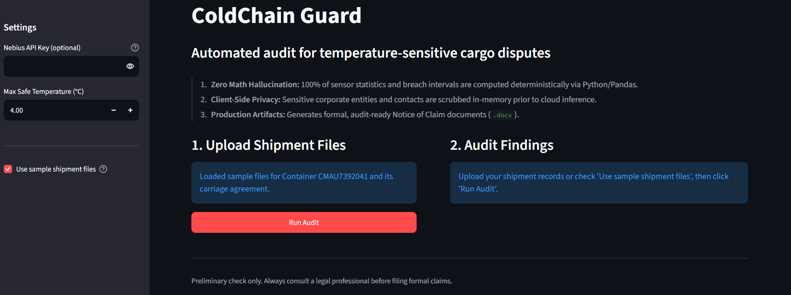
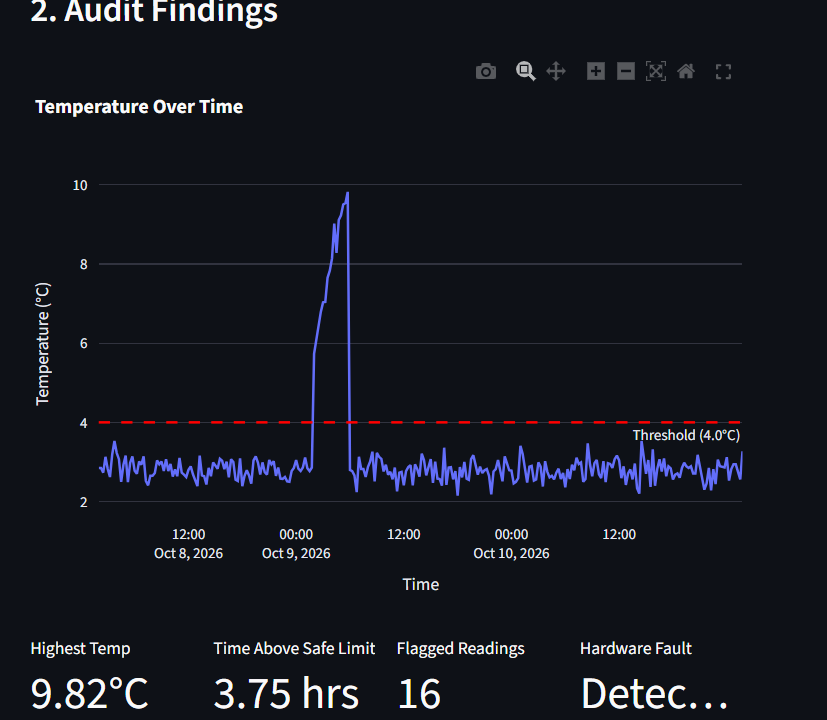
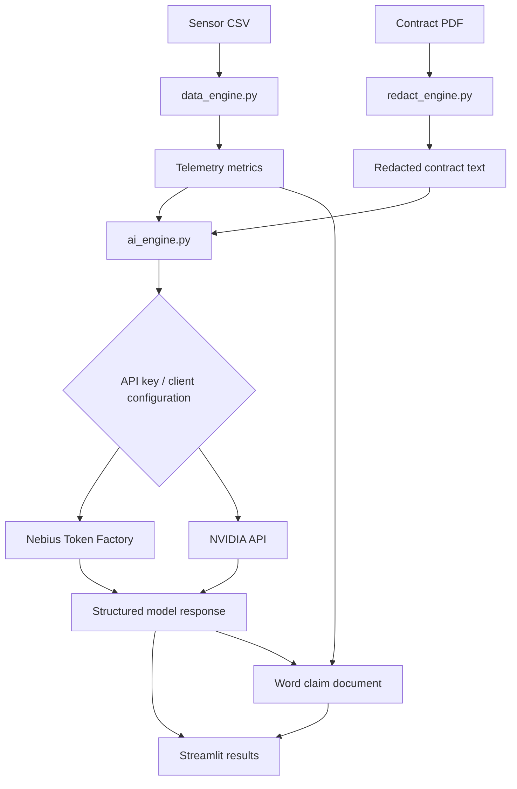

# ColdChain Guard

**An AI-assisted cold-chain shipment auditing and claim-preparation app powered by NVIDIA Nemotron and Nebius Token Factory.**

ColdChain Guard is a student-built, end-to-end Streamlit application for investigating temperature-sensitive cargo incidents. It combines deterministic telemetry analysis in Python/Pandas, contract-text extraction and redaction, and LLM-assisted contract review to help organize evidence and prepare a claim-document draft in one workflow.

Built for the **NVIDIA x Nebius Hackathon 2026 — Best Apps & Agents Track**.

[](LICENSE)
[](https://www.python.org/)
[](https://streamlit.io/)

## Try ColdChain Guard

- **Live app:** [Open the Streamlit demo](ADD_YOUR_STREAMLIT_DEMO_URL)
- **Video walkthrough:** [Watch the YouTube demo](ADD_YOUR_YOUTUBE_VIDEO_URL)
- **Source code:** [Explore the GitHub repository](https://github.com/kokos-lab17/coldchain-guard)


## Why I built it

Shipping moves goods around the world, including food, medicine, and other products that need to stay within a safe temperature range. When a temperature-sensitive shipment is damaged, the follow-up can be complicated: teams may need to compare sensor logs with a carriage agreement, work out what the evidence shows, and prepare documents before the parties can resolve who is responsible.

That process can turn into a long back-and-forth. I built ColdChain Guard to bring some of those investigation steps into one workflow. It turns shipment readings into structured metrics, prepares contract text for AI-assisted review, and generates an editable claim-document draft from the results.

The idea is simple: **make the evidence easier to review, and make the first steps of claim preparation more organized.**

## What it can do

### 1. Deterministic telemetry analysis with Python and Pandas
- Reads shipment sensor data from CSV files.
- Calculates metrics such as peak temperature, readings above a configurable threshold, and the time span between flagged readings.
- Checks available power-status readings for fault indicators.
- Visualizes temperature readings in an interactive Plotly chart.

**Key design choice:** Python/Pandas calculates the telemetry metrics before the model is called. This keeps numerical processing separate from the LLM's contract interpretation and reduces the chance of relying on the model for sensor arithmetic.

### 2. Contract text extraction and redaction
- Extracts text from PDF carriage agreements.
- Uses regular-expression rules to identify selected types of identifiers.
- Replaces detected values with redaction markers before the contract text is sent in the model request.
- Shows redaction results in the dashboard.

This creates a clear preprocessing step between the original contract and the AI review.

### 3. AI-assisted contract review with NVIDIA Nemotron
- Uses **NVIDIA Nemotron 3.5 Lightning** as the configured model family.
- Uses the OpenAI Python SDK's chat-completions interface to send the telemetry summary and redacted contract text to the selected inference endpoint.
- Requests a structured JSON-style assessment containing a liability indication, contract clause, reasoning, financial exposure, and claim-letter text.
- Parses the response into fields that the dashboard and Word document generator can use.

**Why separate Python and AI?** The telemetry engine provides the calculated shipment facts; the model is asked to interpret those facts alongside the contract language. This division of work is a deliberate part of the design—not an attempt to make the LLM do every step.

### 4. NVIDIA and Nebius endpoint routing
The app uses an OpenAI-compatible request interface and supports routing to both provider ecosystems based on the configured API key:

- **Nebius Token Factory:** the default Nebius endpoint is configured with the `nvidia/Nemotron-3_5-Lightning` model identifier.
- **NVIDIA API:** keys beginning with `nvapi-` route to NVIDIA's API endpoint with the `nvidia/nemotron-3.5-lightning-30b-a3b` model identifier.

This made it possible to develop and test the same general application workflow across NVIDIA and Nebius endpoints. The provider's endpoint and model identifier are selected by the client configuration.

### 5. Editable Word claim document
- Generates a downloadable `.docx` file using `python-docx`.
- Brings telemetry metrics, the cited contract clause, financial-exposure field, reasoning, and claim-letter text into one document.
- Lets users review and edit the draft after downloading it.

### 6. Interactive Streamlit dashboard
- Start with the included sample shipment files or upload a sensor CSV and contract PDF.
- Set the temperature threshold.
- Run the audit from the app interface.
- Review the chart, metrics, redaction results, and model assessment.
- Download the generated Word document.

## Demo screenshots



*The main dashboard and shipment inputs.*



*Shipment readings visualized against the configured temperature threshold.*


*Redaction results shown in the app.*


*The structured assessment generated by the AI workflow.*


*An example of the editable claim-document output.*

## How it works



## Project structure

| File | What it does |
|---|---|
| `app.py` | Streamlit interface, file uploads, settings, workflow, results, and downloads |
| `data_engine.py` | CSV processing, temperature metrics, power-status checks, and chart generation |
| `redact_engine.py` | PDF text extraction and contract-text redaction |
| `ai_engine.py` | Provider selection, model requests, response parsing, and Word document generation |
| `sample_readings.csv` | Example shipment telemetry |
| `output.pdf` | Sample contract PDF used in the demo |
| `requirements.txt` | Python dependencies |
| `.env.example` | Example local environment configuration |

## Built with

- **Python** — application logic
- **Pandas** — telemetry processing
- **Streamlit** — interactive interface
- **Plotly** — data visualization
- **pypdf** — PDF text extraction
- **OpenAI Python SDK** — OpenAI-compatible chat-completions requests
- **NVIDIA Nemotron 3.5 Lightning** — configured model family
- **Nebius Token Factory / NVIDIA API** — inference endpoints
- **python-docx** — Word document generation
- **python-dotenv** — local environment configuration

## Run it locally

### What you’ll need
- Python 3.10 or newer
- Git
- An API key for a supported inference provider

### 1. Clone the repository

```bash
git clone https://github.com/kokos-lab17/coldchain-guard.git
cd coldchain-guard
```

### 2. Create and activate a virtual environment

**Windows**

```powershell
python -m venv venv
venv\Scripts\activate
```

**macOS / Linux**

```bash
python3 -m venv venv
source venv/bin/activate
```

### 3. Install dependencies

```bash
pip install -r requirements.txt
```

### 4. Configure your API key

Copy `.env.example` to `.env`, then add your provider key. For example:

```env
NEBIUS_API_KEY=your_nebius_api_key_here
```

For local NVIDIA API testing, you can also use:

```env
NVIDIA_API_KEY=your_nvidia_api_key_here
```

The app can also accept a key through the sidebar.

**Want to try the hosted demo instead?** An API key is configured in Streamlit Secrets for the deployed app, so you can explore it without entering your own key. If you run the project on your own machine, configure a key using one of the local options above.

### 5. Start the app

```bash
streamlit run app.py
```

Open the local URL printed by Streamlit, usually `http://localhost:8501`.

## Try the sample workflow

1. Open ColdChain Guard.
2. Select the included sample shipment files, or upload a CSV and contract PDF.
3. Set the temperature threshold.
4. Run the audit.
5. Explore the telemetry chart, metrics, redaction results, and AI assessment.
6. Generate and download the Word claim document.

## What I learned building it

ColdChain Guard brought several parts of application development together in one project: processing real-looking sensor data, extracting and sanitizing document text, integrating model APIs, handling structured responses, and turning the results into a usable interface and downloadable document.

It was also a chance to think carefully about where deterministic code is a better fit than generative AI, and where a language model can help interpret context that is harder to express as simple rules. That combination is what makes the project interesting to me—and a foundation I can continue building on.

## License

This project is licensed under the MIT License. See [LICENSE](LICENSE) for details.

## Acknowledgements

Built for the **NVIDIA x Nebius Hackathon 2026 — Best Apps & Agents Track**.

- [NVIDIA](https://www.nvidia.com/) — AI and inference ecosystem
- [Nebius Token Factory](https://nebius.com/token-factory) — hosted model inference
- [Streamlit](https://streamlit.io/) — app framework
