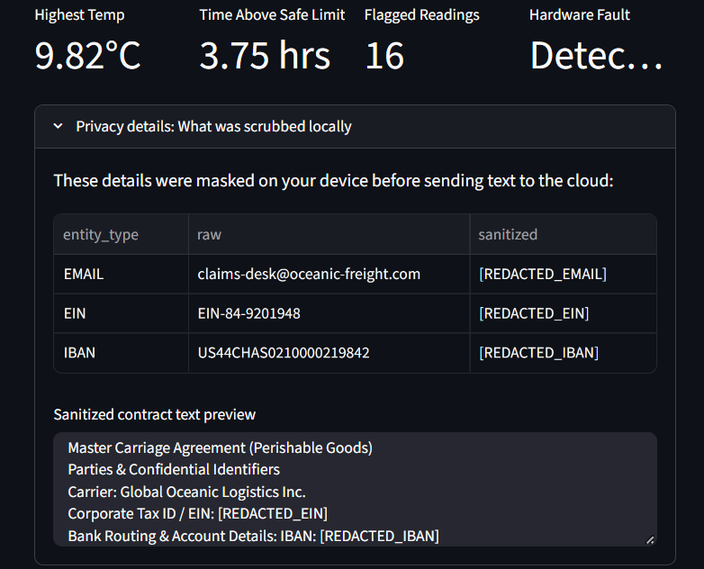
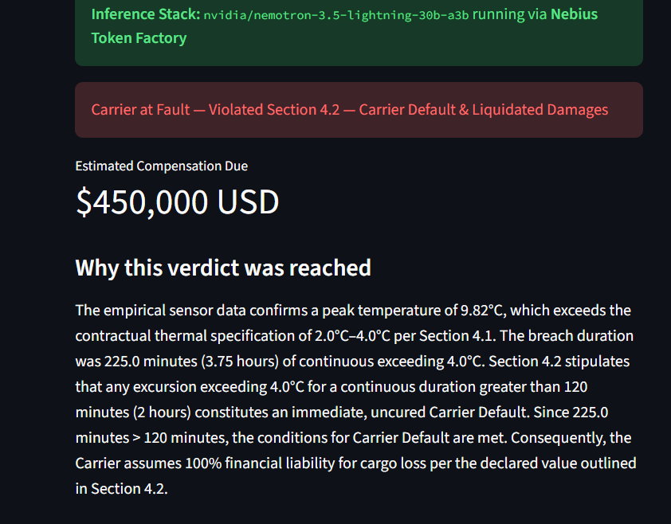
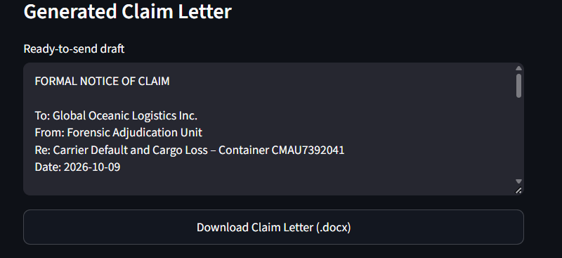

# ColdChain Guard 

> **Autonomous Cold Chain Dispute Adjudicator & Evidence Generator**  
> *Built for the NVIDIA x Nebius Hackathon (Best Apps & Agents Track)*

[](https://opensource.org/licenses/MIT)
[](https://share.streamlit.io/)
[](https://huggingface.co/nvidia)
[](https://nebius.com/token-factory)

---

## Why this project?

Every year, over **$35 billion** worth of perishable pharmaceuticals and bioproducts are wasted due to cold chain failures during transit. When temperature breaches happen, cargo claims get bogged down in weeks of bureaucratic disputes: carriers point fingers at freight forwarders, insurers demand forensic proof, and claims handlers spend dozens of hours manually correlating raw sensor logs with complex legal contracts.

**ColdChain Guard** solves this through an autonomous, edge-to-cloud forensic agent pipeline:
1. **Deterministic Telemetry Audit**: Uses Pandas to scan raw IoT sensor logs, computing exact continuous breach windows and hardware power failures.
2. **Local PII/NPI Sanitization Engine**: Scrubs sensitive business data (names, corporate entities, contact details) in-memory before sending text to any cloud API.
3. **Reasoning-Driven Adjudication**: Leverages **NVIDIA Nemotron 3.5 Lightning (30B)** hosted on **Nebius Token Factory** to cross-reference sensor facts against contractual carriage terms.
4. **Court-Ready Legal Artifact Generation**: Outputs instant structured verdicts and a downloadable, formal Notice of Cargo Discrepancy (`.docx`) citing violated clauses and demanded remedies.

---

## Key Architectural Pillars (The MVPs)

| Feature | The Problem | How ColdChain Guard Solves It |
|---|---|---|
| **Deterministic Telemetry Audit** | LLMs frequently hallucinate timestamps, misread decimal degrees, and fail at calculating continuous breach intervals. | **Python & Pandas handle 100% of the math.** Sensor logs are parsed deterministically on-device to compute exact excursion minutes and peak temperatures before the model is ever called. |
|**Zero-Leakage Privacy Engine** | Uploading full commercial contracts to cloud LLMs exposes sensitive corporate EINs, bank accounts, and contact details. | **On-device regex masking** sanitizes all personal identifiable information (PII) and commercial identifiers in-memory before prompt construction. |
|**Automated Legal Artifacts** | Chatbots output informal text snippets that still require manual drafting into formal notices. | **Instant `.docx` legal synthesis.** Compiles verified sensor facts and Nemotron's contractual breach citations into an editable, standard-compliant Notice of Claim. |

---

## Demo & Screenshots

### 1. Interactive Forensic Dashboard & Telemetry Audit


*Interactive Plotly telemetry curve mapping ambient container temperatures against contractual safe limits.*

### 2. Local PII Redaction & In-Memory Privacy Scrubbing

*Auditable diff table showing client entity masking executed entirely client-side prior to model inference.*

### 3. Formal Adjudication & Notice of Claim Generation



*Deterministic verdict with cited breach clauses, financial indemnification demands, and downloadable formatted `.docx` notice.*


---

## System Architecture

```text
       Raw IoT Data                Carriage Agreement
      (CSV Sensor Logs)                 (PDF Contract)
             │                                │
             ▼                                ▼
┌─────────────────────────┐      ┌─────────────────────────┐
│     data_engine.py      │      │    redact_engine.py     │
│  - Continuous breaches  │      │  - In-memory regex      │
│  - Peak excursion temp  │      │  - Entity sanitization  │
│  - Power fault markers  │      │  - Zero data leakage    │
└────────────┬────────────┘      └────────────┬────────────┘
             │                                │
             └───────────────┬────────────────┘
                             ▼
                ┌─────────────────────────┐
                │       ai_engine.py      │
                │  Dynamic Client Router  │
                └────────────┬────────────┘
                             │
            ┌────────────────┴────────────────┐
            ▼                                 ▼
┌─────────────────────────┐       ┌─────────────────────────┐
│  Nebius Token Factory   │       │  Local Dev Fallback     │
│  Nemotron 3.5 Lightning │       │  (NVIDIA NIM API)       │
└────────────┬────────────┘       └────────────┬────────────┘
             └────────────────┬────────────────┘
                              ▼
                ┌─────────────────────────┐
                │   Forensic Claim DOCX   │
                │   & Interactive UI      │
                └─────────────────────────┘
```

---

## Key Features

* **Empirical Grounding (Zero Hallucination)**: Mathematical fact extraction happens deterministically in Python. The LLM only interprets liability and applies contractual clauses against verified facts.
* **Enterprise-Grade Data Privacy**: Sensitive entity names, email addresses, and phone numbers are scrubbed locally before prompt delivery.
* **Dynamic Multi-Provider Adapter**: Native support for **Nebius Token Factory** OpenAI-compatible inference with seamless developer fallback.
* **Production Artifact Generation**: Generates clean, ready-to-file legal indemnity claim letters conforming to maritime dispute standards.
* **Instant Sample Testing**: Includes pre-loaded cold chain telemetry and sample master carriage contracts for instant one-click evaluation.

---

## Technology Stack

| Layer | Component | Description |
|---|---|---|
| **Inference Engine** | Nebius Token Factory | High-throughput, low-latency OpenAI-compatible endpoints |
| **Reasoning Model** | NVIDIA Nemotron 3.5 Lightning (30B) | Advanced reasoning and legal discrepancy analysis |
| **Frontend UI** | Streamlit | Responsive, real-time forensic dashboard |
| **Data Analytics** | Pandas & NumPy | Numerical timeseries evaluation & breach interval analysis |
| **Visualization** | Plotly Graph Objects | Interactive timeseries telemetry graphs |
| **Document Pipeline**| PyMuPDF / python-docx | PDF contract extraction & Word document compilation |

---

## Quickstart Guide

### Prerequisites
* Python 3.10+ installed
* Git installed

### 1. Clone the Repository
```bash
git clone [https://github.com/YOUR_USERNAME/coldchain-guard.git](https://github.com/YOUR_USERNAME/coldchain-guard.git)
cd coldchain-guard
```

### 2. Set Up a Virtual Environment
```bash
# Windows
python -m venv venv
venv\Scripts\activate

# macOS / Linux
python3 -m venv venv
source venv/bin/activate
```

### 3. Install Dependencies
```bash
pip install -r requirements.txt
```

### 4. Configure Environment Variables
Copy the template configuration file:
```bash
cp .env.example .env
```
Open `.env` and insert your API credentials:
```env
NEBIUS_API_KEY=your_token_factory_key_here
```

### 5. Launch the Application
```bash
streamlit run app.py
```
The app will open automatically in your browser at `http://localhost:8501`.

---

##  Testing with Included Sample Data

For instant evaluation without external files:
1. Ensure the **"Use sample shipment files"** checkbox is checked in the left sidebar.
2. *(Optional)* Provide your API key in the sidebar, or leave it blank to use the `.env` / server configuration.
3. Click **"Run Audit"**.
4. Inspect the interactive telemetry excursion graph, verify the locally scrubbed PII entities, and download the compiled **Notice of Claim (.docx)**.

---

##  Security & Privacy Notice

ColdChain Guard enforces strict enterprise confidentiality:
* Contract documents are processed in-memory and are never stored to persistent server disks.
* All telemetry and contract parsing undergo on-device regex masking for sensitive personal identifiable information (PII) before any prompt is transmitted to the inference endpoint.
* Streamlit secrets and cloud keys are strictly maintained server-side.

---

##  License

This project is licensed under the **MIT License** — see the [LICENSE](LICENSE) file for details.

---

## Acknowledgements & Hackathon Feedback

Built with passion for the **NVIDIA x Nebius Hackathon 2026**.

* **Nebius Token Factory**: Outstanding inference latency, smooth OpenAI SDK compatibility, and reliable handling of heavy context windows.
* **NVIDIA Nemotron 3.5 Lightning**: Exceptional structured reasoning capabilities for multi-page contractual documents and zero-hallucination constraint compliance.
